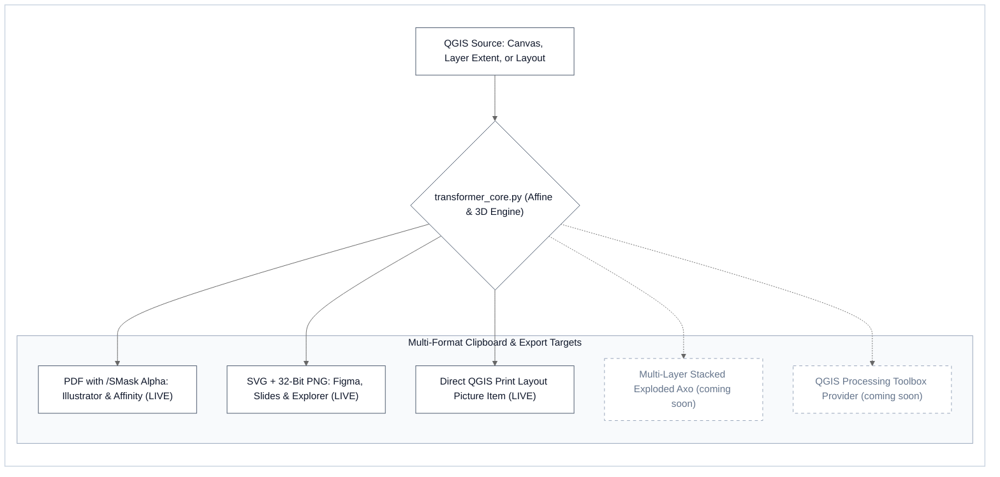
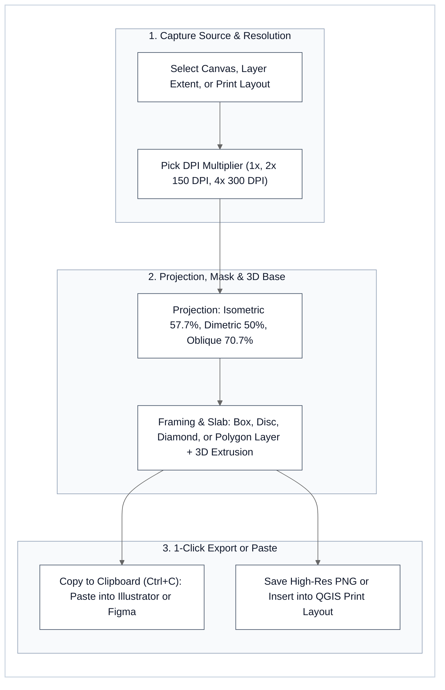

# Axonometric Map Transformer - 1-Click 3D Isometric & Oblique Diagram Generator for QGIS 3 & 4

[](https://github.com/iscvlab/qgis-axonometric-transformer)
[](https://plugins.qgis.org/plugins/axonometric_transformer/)
[](https://plugins.qgis.org/plugins/axonometric_transformer/)
[](https://github.com/iscvlab/qgis-axonometric-transformer)
[](https://qgis.org)
[](./LICENSE)
[](https://plugins.qgis.org/plugins/axonometric_transformer/)

**Axonometric Map Transformer** (`axonometric_transformer`, **Official QGIS Plugin ID `#6219`**, `v1.2.2 LIVE` on [`plugins.qgis.org`](https://plugins.qgis.org/plugins/axonometric_transformer/)) is a 1-click **2D-to-3D isometric, dimetric, and oblique map diagram engine** engineered by **[ISCV | Isocurve Research Lab (`@iscvlab`)](https://github.com/iscvlab)**. It eliminates the manual *"Export 2D Map → Switch to CAD/Illustrator → Rotate → Shear → Squash → Clip → Extrude Slab"* pipeline—transforming the active QGIS map canvas, selected vector layer extents, or print layouts into presentation-ready 3D axonometric plates with **1-click transparent clipboard copy (`Ctrl+C` / `Cmd+C`)** directly into **Adobe Illustrator, Figma, Affinity Designer, Photoshop, and presentation decks**.

Sister toolkits & upstream contributions: **[boostx](https://github.com/iscvlab/boostx)** (13-Skill `/x*` Agent Ecosystem & `/xpublish` Qt6 Packager) · **[mcp-bridges](https://github.com/iscvlab/mcp-bridges)** (`/qgis`, `/rhino`, `/grasshopper`, `/illustrator`, `/figma` MCP Bridges) · **[xocr](https://github.com/iscvlab/xocr)** (Hybrid Document AI & Local `SCB 10X Typhoon-OCR v1.5` × `Baidu Unlimited-OCR-2` Engine · **[Upstream PR #15 to `scb-10x/typhoon-ocr`](https://github.com/scb-10x/typhoon-ocr/pull/15)**).

---

## ⚡ TL;DR - Capabilities & Workflow Speed at a Glance (`v1.2.2`)

* **1-Click In-QGIS 3D Diagram Engine (`~4 s` vs `~120 s` Manual)**: Captures your active QGIS canvas, selected polygon layer extent, or Print Layout at up to `300 DPI` (`4×`) and applies true mathematical **Isometric (`30°-30°`, `57.74%`)**, **Dimetric (`2:1`, `50.00%`)**, or **Military Oblique (`45°`, `70.71%`)** projections with Painter's-algorithm 3D base slab extrusion.
* **Multi-Format Transparent Clipboard (`Ctrl+C` / `Cmd+C`)**: Simultaneously registers in-memory vector **PDF with `/SMask` soft-mask alpha** (Adobe Illustrator / Affinity Designer), **SVG** (`image/svg+xml` for Figma), **32-bit ARGB32 PNG** (`image/png` for Slides / Photoshop / Discord), and **Windows `CF_HDROP` file drops**—while suppressing `text/plain` (so Illustrator never pastes a file path) and `CF_DIB` (so Windows never renders black alpha backgrounds).
* **100% Qt5 / Qt6 Dual-Compatible (`QGIS 4 Ready`)**: Built on `100%` native `qgis.core` and `qgis.PyQt` (`2,359 LOC` across runtime modules + `345 LOC` unit tests) with zero external pip dependencies, passing `check_qt6.py` scoped-enum AST verification and `plugins.qgis.org` security scan with **`0` issues**.
* **Which Projection & Framing Mode Should You Choose?**
  * **Isometric (`30°-30°`, `H/W = 1/√3 ≈ 57.74%`)**: Standard architectural masterplan & exploded layer stacking.
  * **Dimetric (`2:1`, `H/W = 50.00%`)**: Low-angle urban skyline & corridor diagrams with enhanced vertical relief.
  * **Military Oblique (`45°`, `H/W ≈ 70.71%`)**: Preserves legible street grids and dense typography on city-scale maps.

### Horizontal Bar Comparison (Plugin `v1.2.2` vs. Manual CAD / Illustrator Workflow)

| Evaluation Dimension | Workflow / Configuration | Visual Comparison Bar | Measured Result & Delta vs. Baseline |
| :--- | :--- | :--- | :--- |
| **1. Diagram Production Speed ↑**<br>*(QGIS Canvas → 3D Plate in Illustrator)* | **Plugin 1-Click Render + `Ctrl+C` (`v1.2.2`)**<br>Manual Export → Rotate → Shear → Extrude | `████████████████████` **`30.0× Faster`**<br>`█░░░░░░░░░░░░░░░░░░░` `1.0× Baseline` | **`~4.0 s` (`1` Click + Direct `Ctrl+V` Paste)** ✨<br>`~120.0 s` (`7` Manual GIS-to-Illustrator Steps) |
| **2. Transparent Clipboard Coverage ↑**<br>*(Simultaneous Single-Copy Formats)* | **`v1.2.2` Multi-Format Engine (`4` MIME/OS)**<br>Standard `QClipboard.setImage()` Baseline | `████████████████████` **`100.0% (4/4 Targets)`**<br>`█████░░░░░░░░░░░░░░░` `25.0% (1/4 Targets)` | **`PDF /SMask` + `SVG` + `PNG` + `CF_HDROP`** ✨<br>Raster Only (Black `CF_DIB` Box in Illustrator) |
| **3. Cross-Version Qt6 / QGIS 4 Pass ↑**<br>*(`check_qt6.py` Scoped Enum AST Gate)* | **`v1.2.2` Scoped PyQt5/PyQt6 Architecture**<br>Legacy Unscoped PyQt5 Plugin Code | `████████████████████` **`100.0% (0 Issues)`**<br>`██████████░░░░░░░░░░` `50.0% (Qt5 Only)` | **Official `QGIS 4 Ready` Badge (`3.16+ & 4.x`)** ✨<br>Crashes on QGIS 4 Startup (`AttributeError`) |
| **4. External Dependency Footprint ↓**<br>*(Lower = Better)* | **Pure Native `qgis.core` + `qgis.PyQt`**<br>External Binary Wrapper Plugins | `░░░░░░░░░░░░░░░░░░░░` **`0 External Deps`**<br>`████████████████████` `3-5 Pip Wheel Deps` | **1-Click Install on Windows, macOS & Linux** ✨<br>Requires Manual OS Python Environment Setup |

---

## 1. Architecture & 3-Step Usage Workflow

### A. In-Memory Affine Projection, 3D Base Extrusion & Multi-Format Clipboard Architecture



### B. 3-Step Usage Workflow Inside QGIS Desktop



---

## 2. Key Features & Mathematical Projections

| # & Feature Pillar | Core Mechanism (`transformer_core.py` & `transformer_dialog.py`) | Supported Modes & Parameters | Architectural Impact |
| :--- | :--- | :--- | :--- |
| **1. Direct In-QGIS Capture** | Offscreen `QgsMapSettings` + `QgsMapRendererParallelJob` & `QgsLayoutExporter` with transparent `Format_ARGB32` buffer. | `Active Map Canvas` • `Selected Layer Extent` (custom `%` padding) • `QGIS Print Layout` • `1×` / `2× (150 DPI)` / `4× (300 DPI)`. | Renders clean map vectors and labels with `100%` transparent alpha background for multi-layer stacking. |
| **2. Mathematical Projections** | Exact 2D affine rotation (`-180°` to `+180°` with `-45°`, `0°`, `+45°`, `+90°` presets) followed by vertical ground-plane compression. | **Isometric (`30°-30°`)**: `H/W = 1/√3 ≈ 57.735%`<br>**Dimetric (`2:1`)**: `50.00%`<br>**Military (`45°`)**: `70.71%`<br>**Custom**: `20%-100%`. | Eliminates manual trig scaling in external graphic software while preserving crisp antialiasing. |
| **3. Framing & 3D Base Plate** | Vector clipping path generator + Painter's-algorithm depth-sorted 3D slab wall extrusion with dynamic winding order. | `Tight Bounding Box` • `Circular Site Disc` • `Isometric Diamond` • `Polygon Vector Layer Mask` • `5%`-stepped opacity sliders. | Clips the axonometric map directly to any site boundary polygon and extrudes a shaded 3D architectural pedestal. |
| **4. Multi-Format Clipboard** | Custom `QMimeData` + Windows OLE `IDataObject` bundle (`PDF /SMask` + `SVG` + `PNG` + `CF_HDROP`) + direct Print Layout insertion. | `Copy to Clipboard` (`Ctrl+C` / `Cmd+C`) • `Save High-Res PNG` • `Insert into QGIS Print Layout`. | 1-click `Ctrl+V` paste into Adobe Illustrator, Figma, Affinity Designer, Photoshop, Slides, and File Explorer. |

<details>
<summary><b>Deep Technical Reference — Multi-Format Transparent Clipboard & Qt5/Qt6 Scoped Enum Specification</b></summary>

### A. Multi-Format Clipboard MIME & OS Format Matrix (`v1.2.2`)

| Clipboard Format / Key | Payload Encoding | Target Host Applications | Engineering Guardrail |
| :--- | :--- | :--- | :--- |
| **`application/pdf`** | PDF 1.4 stream with `/FlateDecode` RGB `/XObject` + `/SMask` 8-bit grayscale alpha soft mask | **Adobe Illustrator**, **Affinity Designer** | Embeds explicit `/SMask` soft-mask stream so Illustrator preserves `100%` background transparency without white bounding boxes. |
| **`image/svg+xml`** | UTF-8 SVG wrapper with embedded base64 `image/png` (`width`, `height`, `viewBox`) | **Figma**, **Inkscape**, Web Browsers | Enables direct `Ctrl+V` vector-container paste onto Figma canvases. |
| **`image/png`** | Lossless 32-bit `Format_ARGB32` PNG byte stream | **Photoshop**, **PowerPoint**, **Canva**, **Discord**, **Slack** | Registered as explicit `image/png` MIME bytes while omitting `mime_data.setImageData()` so Windows GDI `CF_DIB` never turns alpha pixels black. |
| **`text/uri-list` (`CF_HDROP`)** | `QUrl.fromLocalFile(temp_png_path)` | **Windows File Explorer**, macOS Finder | Allows pasting the rendered `.png` file directly into folders while explicitly omitting `mime_data.setText()` so Illustrator never pastes a text frame. |

### B. Qt5 / Qt6 Scoped Enum Forward-Compatibility (`check_qt6.py` Verified)

All PyQt calls use fully scoped enums compatible with both **QGIS 3.x (`PyQt5 / Qt5`)** and **QGIS 4.x (`PyQt6 / Qt6`)**:
- `QImage.Format.Format_ARGB32` & `QImage.Format.Format_Grayscale8`
- `QPainter.RenderHint.Antialiasing` & `QPainter.RenderHint.SmoothPixmapTransform`
- `QPainter.CompositionMode.CompositionMode_DestinationIn`
- `Qt.AlignmentFlag.AlignCenter`, `Qt.AspectRatioMode.KeepAspectRatio`, `Qt.TransformationMode.SmoothTransformation`
- `QPageSize.Unit.Point` & `QPageLayout.Orientation.Portrait`

</details>

---

## 3. Installation & File Architecture

### Method A: Official QGIS Plugin Manager (Recommended - `1-Click Install`)
Available directly in the official QGIS plugin repository (**Plugin ID `#6219`**):
1. Open **QGIS Desktop** (`3.16+` or `4.x`).
2. Navigate to **Plugins → Manage and Install Plugins...**
3. Select the **All** tab and search for **`Axonometric Map Transformer`**.
4. Click **Install Plugin** (installs active release **`v1.2.2`**).

*(The axonometric cube icon appears immediately in your QGIS Toolbar and under **Plugins → Axonometric Map Transformer**).*

### Method B: Developer CLI Installation & Test Suite
Clone this repository and run the cross-platform installer or unit test suite:
```bash
git clone https://github.com/iscvlab/qgis-axonometric-transformer.git
cd qgis-axonometric-transformer

# Install / symlink into your active QGIS profile plugins directory:
python install_plugin.py

# Run the standalone mathematical projection, disc base & layer mask unit tests:
pytest test_core.py test_disc_base.py test_layer_mask.py test_transformation.py
```

### File Architecture (`2,359 LOC` Runtime + `345 LOC` Tests)

```text
axonometric_transformer/
├── metadata.txt              # Official QGIS Portal metadata (Plugin ID #6219, v1.2.2)
├── __init__.py               # QGIS classFactory(iface) initialization entrypoint (17 LOC)
├── plugin.py                 # QGIS menu and toolbar action hooks (69 LOC)
├── transformer_core.py       # Affine projection, polygon mask & 3D slab extrusion engine (713 LOC)
├── transformer_dialog.py     # Qt5/Qt6 interactive preview UI & multi-format clipboard (1,560 LOC)
├── icon.png / icon.svg       # Plugin toolbar icons (PNG & SVG)
└── test_*.py                 # 4-module projection, base slab & mask test suite (345 LOC)
```

---

## 4. Author, Related Toolkits & License

- **[Official QGIS Plugin Portal Listing (`#6219`)](https://plugins.qgis.org/plugins/axonometric_transformer/)**: Live `v1.2.2` release (`QGIS 4 Ready`, `100%` security scan pass).
- **[boostx (`v3.3.0`)](https://github.com/iscvlab/boostx)**: Composable 13-skill `/x*` AI agent ecosystem (including `/xpublish` `package_qgis.py` & `check_qt6.py` used to package and verify this plugin).
- **[mcp-bridges](https://github.com/iscvlab/mcp-bridges)**: Model Context Protocol automation bridges for **QGIS (`/qgis`), Rhino 3D, Grasshopper, Adobe Illustrator, and Figma**.
- **[xocr (`v2.1.0`)](https://github.com/iscvlab/xocr)**: High-speed C++ PyMuPDF vector/table extractor & local `SCB 10X Typhoon-OCR v1.5` × `Baidu Unlimited-OCR-2` Document AI engine (**[Upstream PR #15 to `scb-10x/typhoon-ocr`](https://github.com/scb-10x/typhoon-ocr/pull/15)**).

**Napat Phasundhiae**  
*Computational Design Technologist | Spatial Analytics • Urban & Environmental Simulation • Workflow Automation*  
- GitHub: [@napattan](https://github.com/napattan) · [ISCV | Isocurve Research Lab (@iscvlab)](https://github.com/iscvlab)
- LinkedIn: [linkedin.com/in/napatphas](https://www.linkedin.com/in/napatphas/)

Licensed under the **GNU General Public License v3.0 (GPL-3.0)** - see the [LICENSE](LICENSE) file for details.
